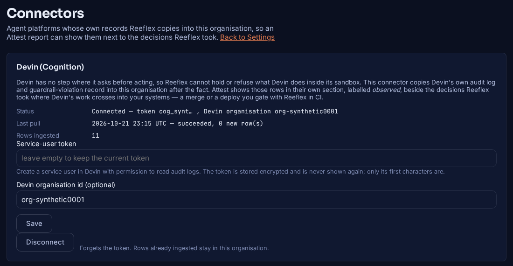
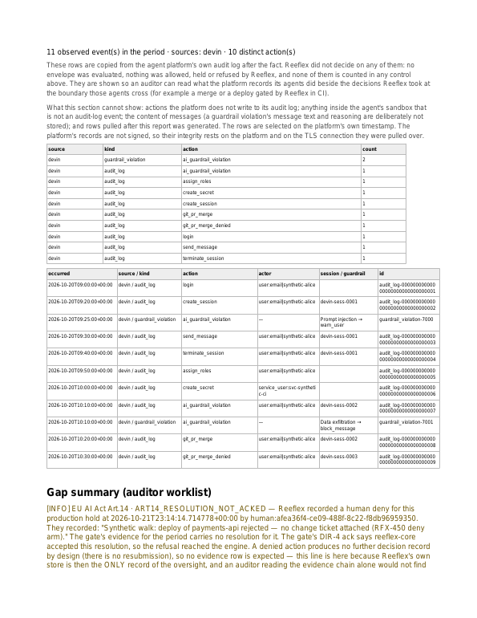
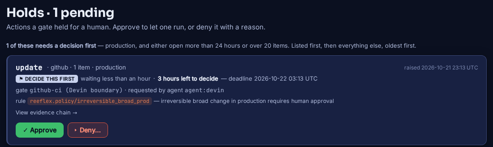

# Devin (Cognition): post-hoc evidence + a boundary gate

**Devin proposes, Reeflex holds the irreversible step.** This page covers two
separate pieces, and neither of them is inline control over Devin:

| | **Post-hoc evidence** | **Boundary gate** |
|---|---|---|
| what it does | copies Devin's audit log and guardrail violations into your Reeflex organisation | asks `reeflex-core` before a CI job merges a Devin pull request or deploys |
| when | after the fact, on a schedule | before the merge or deploy step runs |
| where it runs | the Reeflex app (`reeflex-app ingest devin`) | your GitHub Actions workflow |
| what Reeflex decides | nothing: the rows are labelled *observed* | allow, deny, or hold for a human |
| in Attest | its own section, counted in no control | the ordinary decision chain and the Art.14 hold trail |

!!! warning "What this covers and what it does not"

    Devin's API offers sessions, messages, secrets, knowledge, playbooks,
    enterprise audit logs and guardrail-violation records. It has no webhook,
    approval or policy endpoint, and its AI Guardrails screen the *messages*
    sent to Devin, not the actions Devin takes. So Reeflex does not see, hold or
    refuse anything Devin does inside its sandbox: shell commands, file edits,
    browsing, calls to services Devin holds credentials for. What Reeflex sees is
    (a) what Devin's own audit log records, after the fact, without a
    signature (its integrity rests on Devin and on the TLS connection it was
    pulled over), and (b) the steps that run in **your** CI, where this gate
    sits. A change that reaches production without passing through a gated CI
    step, or a merge on a branch where the gate is not a required check, is not
    seen by the gate. The gate decides on what the workflow declares about the
    change (the paths it touches, the axes in the envelope below). It does not
    read the diff, so whether a change is risky is up to the path list you
    configure.

## Part 1 — Devin's audit log as observed rows in Attest

!!! info "Status"

    Shipped in reeflex-app PR #196 (RFX-450), **in review and not yet on
    app.reeflex.io** as of 2026-10-22. Everything below was measured on that
    PR's image against a scratch database.

1. In Devin, create a **service user** that may read audit logs, and copy its
   token (`cog_…`).
2. In Reeflex, open **Settings → Connectors → Devin (Cognition)**. Paste the
   token and, if your enterprise has more than one Devin organisation, the
   organisation id. Saving the token and disconnecting are owner-only actions,
   and both are written to the tenant audit log, which records the token's
   first characters and not the token.
3. The pull runs as `reeflex-app ingest devin`, which an operator schedules
   (cron or a systemd timer). The first pull reads back 30 days. Each later
   pull stops at the newest row it already holds, and a row already held is
   counted as a duplicate rather than stored again (it is keyed on Devin's own id).



**What is read:** Devin's v3 enterprise API,
`/v3/enterprise[/organizations/{org_id}]/audit-logs` and
`/v3beta1/enterprise[/organizations/{org_id}]/guardrail-violations`.

**What is stored:** Devin's id, the action, the actor type and id, the Devin
session id, and the guardrail name and its action. Devin's free-form `data`,
the user's email, and a violation's flagged message text and reasoning are
**not** stored.

**What Attest prints:** a section headed *Observed agent activity (no Reeflex
decision)*. It counts the rows by source, kind and action and lists them,
under a paragraph that says Reeflex did not decide on any of them. They are
not counted in any control, metric or gap. An organisation with no Devin
connector gets the same report it got before, with the same `report_hash`.



## Part 2 — the boundary gate in GitHub Actions

The gate is one stdlib-only Python file plus a workflow. Both are in the repository:
[`integrations/devin/reeflex_boundary_gate.py`](https://github.com/Reeflex-io/reeflex/blob/main/integrations/devin/reeflex_boundary_gate.py)
and
[`integrations/devin/reeflex-boundary-gate.yml`](https://github.com/Reeflex-io/reeflex/blob/main/integrations/devin/reeflex-boundary-gate.yml).

### What it gates

* **Merge:** a pull request whose author is in `REEFLEX_GATE_AUTHORS`
  (default `devin-ai-integration[bot]`) **and** whose changed files match
  `REEFLEX_GATE_PATHS`. The default list is `migrations/`, `infra/`, `*.tf`,
  `*.tfvars`, `Dockerfile`, and CI configuration (`.github/workflows/`,
  `.gitlab-ci.yml`, `Jenkinsfile`, `.circleci/`, `azure-pipelines.yml`). Any
  other pull request exits 0 without asking core, and the job summary says why.
* **Deploy:** `reeflex_boundary_gate.py deploy --target <service>`, as the
  step before your deploy step. It asks every time it runs.

### What core is asked

A merge is sent as an `update` in the `github` namespace on
`target.kind=branch`, with `target.ref=<repo>:<base branch>`, the PR number,
head SHA and matching paths in `params`. It declares itself
`reversibility=irreversible`, `blast_radius=broad`, because a revert commit
does not un-run a migration. A deploy is an `execute` in the `deploy`
namespace. With `environment=production`, core's default pack answers both
with `require_approval` under `reeflex.policy/irreversible_broad_prod` (measured below).

| core answers | the step |
|---|---|
| `allow` | exits 0 |
| `deny` | exits 1 |
| `require_approval` | prints the hold id, polls `GET /v1/holds/{id}`; on approval resubmits the same envelope with the approval attached and exits by that answer; rejected, expired, or past `REEFLEX_WAIT_SECONDS` (default 1800) exits 1 |
| no answer (unreachable, 401, 5xx, unparseable) | exits 1 |

### Install

1. Copy `reeflex_boundary_gate.py` to `.github/reeflex/` and
   `reeflex-boundary-gate.yml` to `.github/workflows/` in the repository Devin
   works on.
2. Set the repository variable `REEFLEX_CORE_URL` and the secret
   `REEFLEX_CORE_TOKEN`.
3. Make the job `reeflex-merge-gate` a **required status check** on the
   protected branch (branch protection or a ruleset). Without that, GitHub
   merges whatever the job says, including a merge Devin performs itself.
4. For deploys, add the step shown at the bottom of the workflow file to your
   deploy job, before the step that deploys.

The workflow runs on `pull_request_target`, so the workflow file and the
script come from the **base** branch. A pull request cannot edit the gate into
`exit 0` and pass its own check. Nothing from the pull request is checked out:
the changed paths are read through the GitHub API. Keep it that way, because
this job holds the core token.

### What the gate needs from your core

* **A core your runners can reach, with an operator token.** Core reads holds
  with its operator token (`REEFLEX_AUTH_TOKEN`) and nothing else. A
  portal-issued gate credential (`rfx_ac_…`) is accepted on `/v1/decide` and refused on the holds
  routes (`reeflex-core/app/server.py`, read, not measured here), so with one the gate
  can raise a hold but cannot see it resolved. It then fails closed and says
  so.
* **An approver core will accept.** Since core 0.2.0 a hold is resolved by
  a verified approver. In practice that means `REEFLEX_RESOLVER_TOKENS` bound
  on the core, and the Reeflex connector carrying the matching
  `resolver_credentials`, so an approval clicked in the portal reaches core.
  The hosted core behind app.reeflex.io reported
  `"holds": {"resolvable": false, "reason": "verification_not_configured"}` on
  its `/healthz` at 2026-10-21T23:08Z. A hold raised there cannot be approved
  today, and expires after its TTL (4 hours), which this gate reads as "do not
  merge".

### What the approver sees

The portal's hold card shows the verb, namespace, environment, gate, agent and
rule: `update · github · production`, `agent:devin`. It does **not** show the
repository, PR number or file list, because core's audit line does not carry
`params`. Match the hold to the CI run by the **hold id**: the CI step prints
it, and the hold's *View evidence chain* drawer shows it.



## Worked example — measured 2026-10-21

Measured on a scratch stack: `reeflex-core` from the image the hosted core runs
(`ghcr.io/reeflex-io/reeflex-core:v0.2.3`, same image id), with one verified
approver bound; the reeflex-app image of PR #196; the shipped connector. The
script was run in a container exactly as the workflow's step runs it, with a
synthetic `pull_request` event. **Not exercised:** a GitHub-hosted runner,
`pull_request_target`, the files API call, and branch protection. No repository
was created for this, so those parts are the workflow file as written, not a
measurement.

```text
$ reeflex_boundary_gate.py merge --event pr.json --changed-files changed.txt
reeflex: devin-ai-integration[bot] changed 1 gated path(s): migrations/versions/0042_add_ledger_index.py
reeflex: require_approval (reeflex.policy/irreversible_broad_prod) -- irreversible broad change in production requires human approval
reeflex: HELD -- hold_id 31d166734abf49a78685e4d89536ec7b, expires 2026-10-22T03:13:02Z
reeflex: approve or reject it at http://<portal>/app/holds
reeflex: hold 31d166734abf49a78685e4d89536ec7b is pending
reeflex: hold 31d166734abf49a78685e4d89536ec7b is approved
reeflex: resubmitted with the approval -> allow (reeflex.policy/approved_resubmission)
exit 0
```

Between "pending" and "approved", a person clicked **Approve** on that hold in
the portal, in a browser. The connector carried the approval to core, and core
recorded `hold_resolution … decided_by human:<approver email>`.

| case | core's answer | exit |
|---|---|---|
| author `a-human-dev`, touches `migrations/` | not asked | 0 |
| author Devin, touches `README.md`, `src/…` | not asked | 0 |
| author Devin, touches `migrations/…` — approved in the portal | `require_approval` → `allow` (`approved_resubmission`) | 0 |
| author Devin, touches `infra/terraform/rds.tf`, `.github/workflows/deploy.yml` — approved | `require_approval` → `allow` | 0 |
| `deploy --target payments-api` — **denied** in the portal, with a reason | `require_approval`, hold `rejected` | 1 |
| wrong `REEFLEX_CORE_TOKEN` | HTTP 401 | 1 |
| core unreachable | — | 1 |
| `REEFLEX_CORE_URL` unset | — | 1 |

The Attest report for that organisation then carries both halves: the three
gate decisions with both holds in the Art.14 trail (the approval with its
approver, the denial with its reason), and in their own section the eleven
Devin rows pulled from a fixture built from Devin's published v3 OpenAPI.
**The Devin rows are synthetic; no live Devin tenant was read.**
